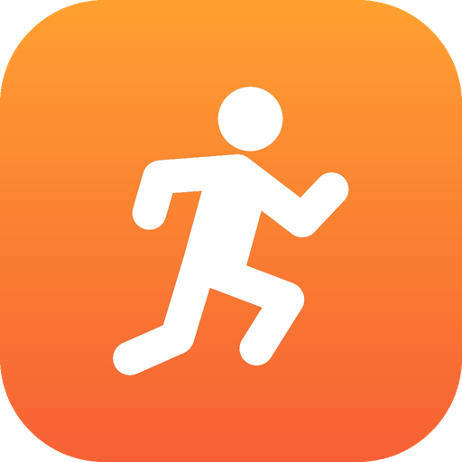
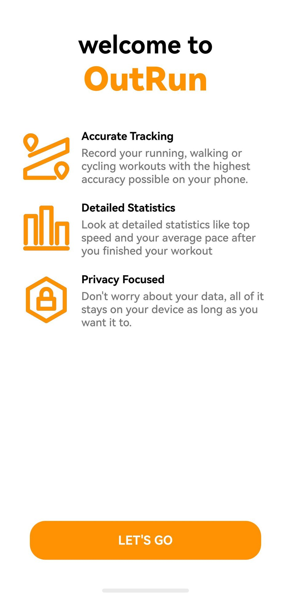
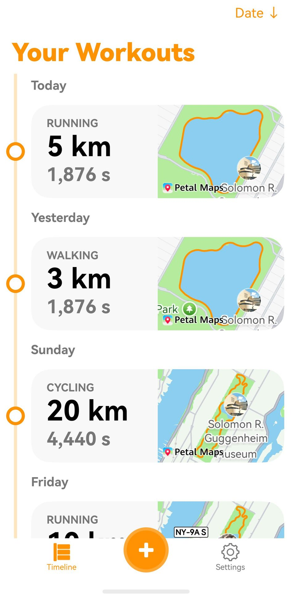
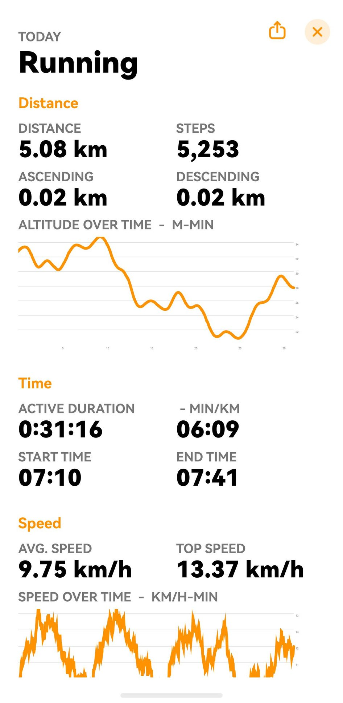
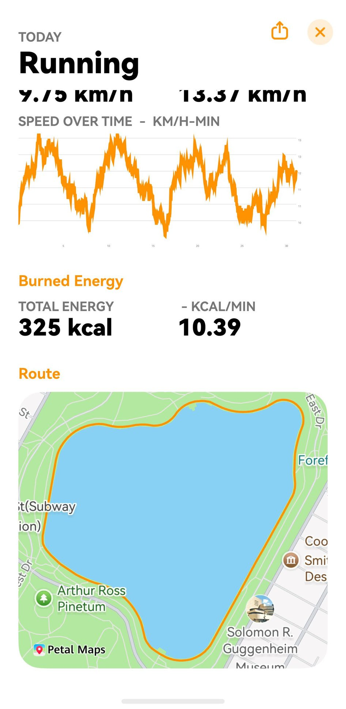
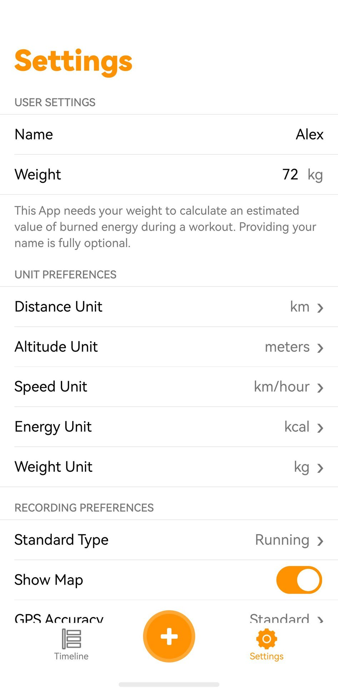

<p align="center"></p>
<h2 align="center"><b>OutRun</b></h2>
<h4 align="center">The privacy-first outdoor workout tracker for iOS, rebuilt natively for HarmonyOS.</h4>

<p align="center"></p>

> ### Please read this first
>
> This is an unofficial community port. It is not affiliated with, endorsed by, or supported by
> Tim Fraedrich or the OutRun project. If something here is broken, it is broken here. Do not open
> an issue upstream for it.
>
> The name OutRun and the app icon belong to their owner. The GPL covers the source code, not the
> name and not the artwork. Both are used here only to say what this is a port of, and both will
> change if the upstream author would rather we did not use them.

<p align="center"><a href="#screenshots">Screenshots</a> &bull; <a href="#install">Install</a> &bull; <a href="#known-limits">Known limits</a> &bull; <a href="#function-list-comparison">Function list comparison</a> &bull; <a href="#license">License</a></p>

<hr>

OutRun is a free, open-source and ad-free app for recording and viewing outdoor workouts: running,
walking, hiking, cycling and skating. It was written for iOS by Tim Fraedrich. This repository is
that app rewritten for HarmonyOS in ArkTS, against ArkUI. It records workouts with GPS, shows the
same statistics, and exports workouts as GPX or as an OutRun backup (`.orbup`). Your data stays on
your phone.

Upstream lives at [timfraedrich/OutRun](https://github.com/timfraedrich/OutRun).
This port is based on OutRun for iOS 1.3 (upstream tag
[`v1.3`](https://github.com/timfraedrich/OutRun/tree/v1.3)).
If you are on an iPhone, go there instead. This port exists for people whose phone runs HarmonyOS
and who want the same tracker on it.

## Screenshots

<p align="center">





</p>

The workouts in these screenshots are made-up demo data. Their routes follow real Central Park
paths taken from OpenStreetMap (&copy; OpenStreetMap contributors, ODbL).

## Install

There is no prebuilt package here. You build it and sign it yourself, which also means the package
carries your certificate and your device list rather than someone else's.

You need DevEco Studio 6.x with the HarmonyOS SDK 6.1.1 (API 24), a Huawei developer account,
and a phone running HarmonyOS.

1. Clone this repository and open the folder in DevEco Studio.
2. Go to **File > Project Structure > Signing Configs**. Sign in, connect the device, and let
   DevEco generate a signature. The bundle name is `com.etspworks.OutRun.hmos`.
3. Build it: **Build > Build Hap(s)/APP(s) > Build Hap(s)**. The package lands in
   `entry/build/default/outputs/default/`.
4. Install and launch it:

```bash
hdc install -r entry-default-signed.hap
hdc shell aa start -a EntryAbility -b com.etspworks.OutRun.hmos
```

A generated debug signature only installs on the devices registered to it, and it expires. When it
does, open the same dialog and generate it again.

## Known limits

- Huawei Health sync is not connected. Apple HealthKit does not exist on HarmonyOS, and Health
  Service Kit needs a separate agreement with Huawei. The Huawei Health screens and buttons are
  there, but they only mark workouts inside OutRun's own database. Nothing is read from or written
  to Huawei Health.
- Route maps use Map Kit, which only works when the bundle is registered in AppGallery Connect with
  the map service turned on. Without that the map area stays empty. Recording, statistics and export
  still work.
- Phones only. There is no tablet or watch layout.

## Function List Comparison

| Category | Rows | Both | iOS | HarmonyOS |
|---|---:|---:|---:|---:|
| Start and setup | 31 | 29 (94%) | 2 | 0 |
| Timeline and sorting | 26 | 25 (96%) | 0 | 1 |
| Recording a workout | 27 | 18 (67%) | 9 | 0 |
| Workout details and map | 37 | 22 (59%) | 13 | 2 |
| Editing a workout | 21 | 17 (81%) | 2 | 2 |
| Settings | 54 | 28 (52%) | 23 | 3 |
| Health sync | 19 | 14 (74%) | 4 | 1 |
| Backup and data | 15 | 8 (53%) | 7 | 0 |
| Global and launch | 18 | 8 (44%) | 9 | 1 |
| **Total** | **248** | **169 (68%)** | **69** | **10** |

Many iOS-only rows are a difference in how finely the two lists were written, not a missing
feature: unit options, error alerts and map gestures that the port has but its list does not count.
The full table, one row per function with a note wherever the two apps differ, is in
[docs/FUNCTION_LIST_COMPARISON.md](docs/FUNCTION_LIST_COMPARISON.md).

## License

GPL-3.0, the same as upstream. `LICENSE` is the upstream file, unchanged:

```
OutRun
Copyright (C) 2020 Tim Fraedrich <timfraedrich@icloud.com>
```

Everything written for HarmonyOS is released under those same terms.

Thanks to the upstream maintainer, contributors and translators, who are credited in the app under
**Settings > Contribution**.

More about OutRun: [outrun.tadris.de](https://outrun.tadris.de)
